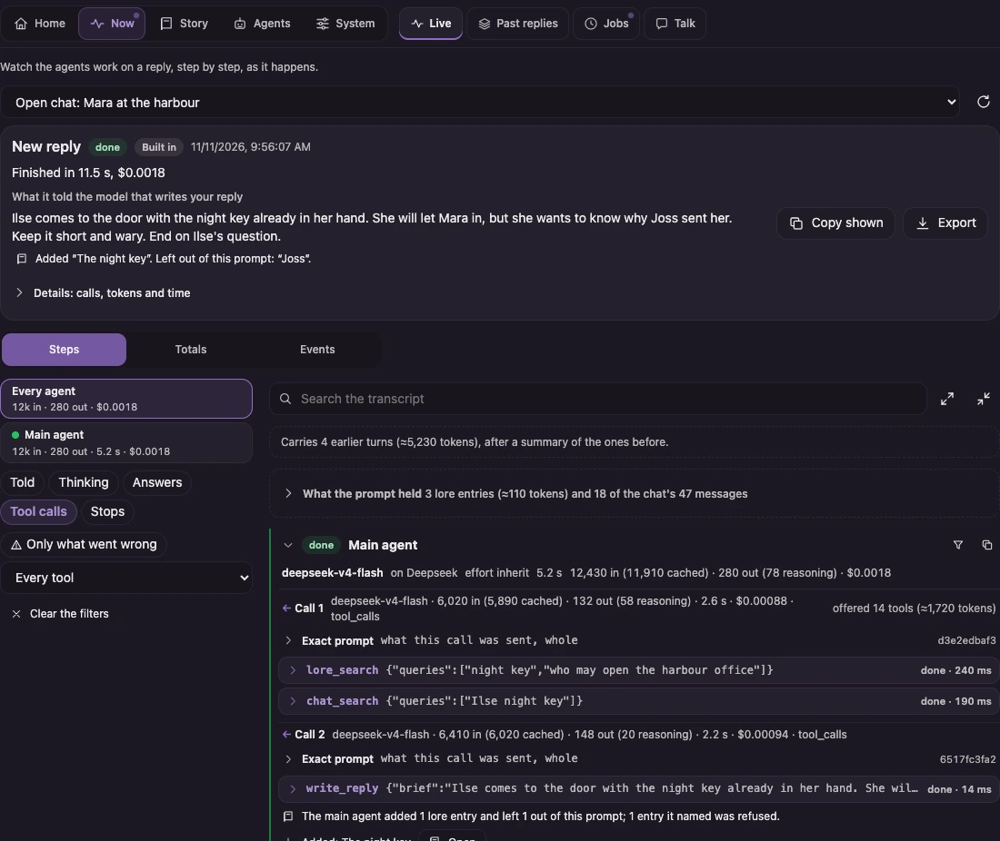
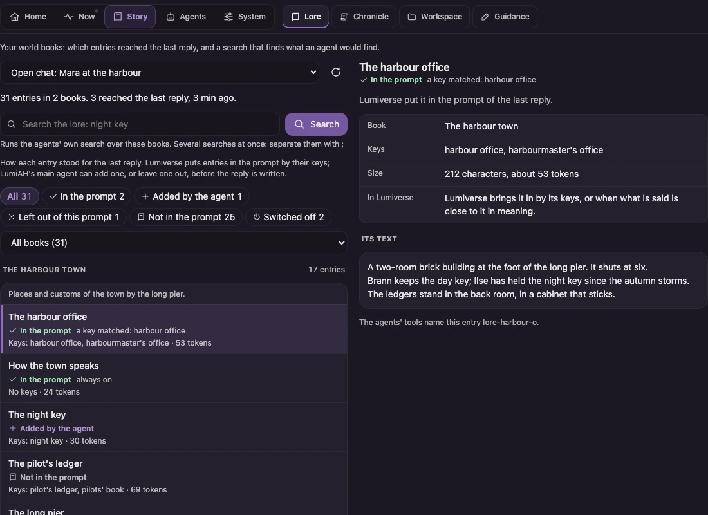
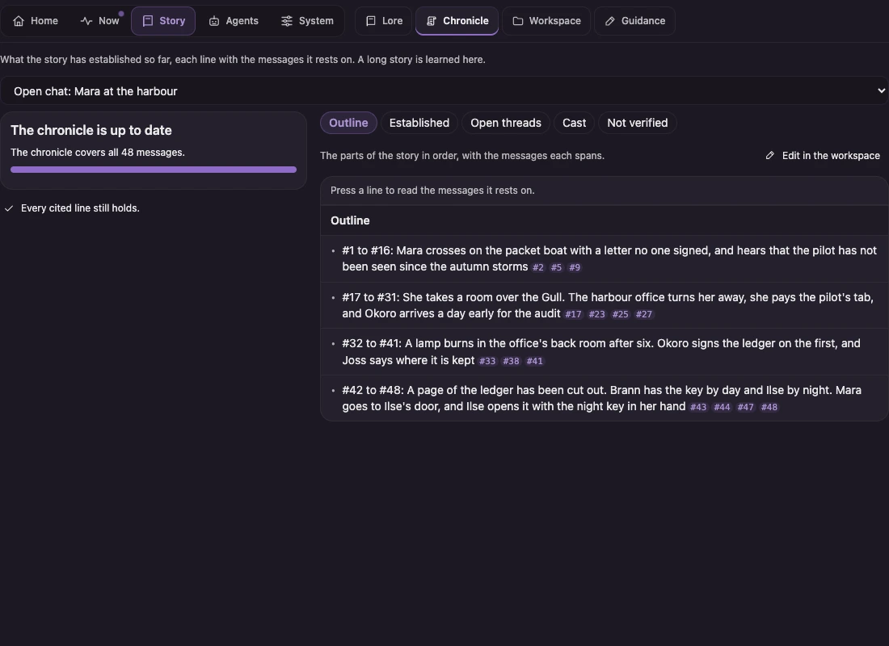
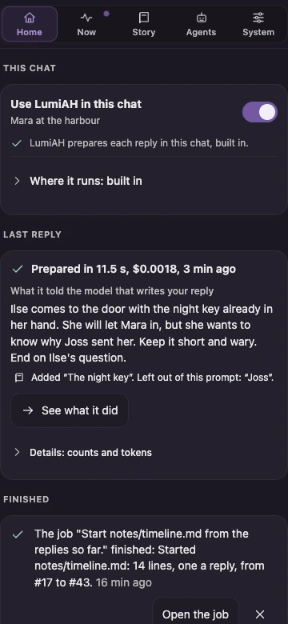

# LumiAH: the Lumiverse Agentic Harness

**An agent does the reading before your model does the writing.**

LumiAH is an extension for [Lumiverse](https://github.com/prolix-oc/Lumiverse). When you press Send, an agent reads the prompt Lumiverse built, works out what the reply needs that the prompt doesn't have, looks it up in your lore and your chat, and hands your model a short brief. Then your model writes the reply, on your connection, under your preset, as it does today.

There is nothing to set up beside the extension. Switch it on for a chat and send a message.



## Why I built it

A long story breaks in two places.

- **Lore the model wasn't shown.** World Info activates on keywords. The entry that matters this turn is often one nobody mentioned by name.
- **History that fell out of the prompt.** Message 40 promised something. By message 400 it is gone, and a summary kept the gist and lost the detail the scene now turns on.

LumiAH puts an agent in front of every reply to close both gaps. It is told what the prompt already holds and what it doesn't, and it has fast tools for the rest.

It is also a general agent harness, in the spirit of the command-line coding harnesses: a main agent in a loop with tools, sub-agents, sessions that carry over and compact, a workspace, guidance files, skills, MCP tools and background jobs. Roleplay is what I built it for. Nothing in it is specific to roleplay.

## What a reply looks like

1. You send a message. Lumiverse assembles the prompt from your preset, as always.
2. The **main agent** reads it. Your preset's instructions are marked as what the reply must achieve. It is told which lore entries are in the prompt and which are not, and which of the chat's messages the prompt carries.
3. It works: a search across the chat for what was last said about the brass key; the two lore entries on the lighthouse that didn't activate; a question handed to another agent.
4. It calls `write_reply` with a brief. It may add lore entries to the prompt, word for word, and leave out ones that don't belong in this scene.
5. **Your model writes the reply.** Same connection, same sampling, same streaming.
6. After the reply, background jobs it started carry on: keeping the story's chronicle up to date, for one.

If LumiAH fails, runs out of time or is skipped, Lumiverse sends the prompt as it was. You always get a reply.

## What you get

### It knows what the prompt holds
Every turn, with no tool call, the agent sees the activated lore by entry, an index of the lore that didn't activate, and which of the chat's messages the prompt carries. It spends its time on what is missing.

### Lore tools built for long stories
Search several questions at once, ranked across titles, keys and text (`lore_search`). Read several entries in one call (`lore_read`). Follow an entry to the entries related to it (`lore_related`). Ask for everything the books hold on one name (`lore_about`). Match a pattern across every entry (`lore_grep`). Where you have an embedding connection and switch it on, search works by meaning as well as by word.



### History at whatever detail the moment needs
- **An outline** of the whole story (`chat_outline`), from your [LumiBooks](https://github.com/AMousePad/LumiBooks) book where you have one (`book_outline`, `book_read`).
- **The trail** of a name or an object through the chat (`chat_about`): first mention, latest, and the lines that matter.
- **Search** by word, by pattern and by meaning (`chat_search`, `chat_grep`), grouped so one exchange doesn't crowd out the rest.
- **The exact messages** when the wording matters (`chat_read`, `chat_around`).

Every message an agent is shown carries a citation, so what it tells your model can be traced back. The chat is never sent to a model whole.

**What counts as the story** is yours to say, in Settings and for one chat at Home: whether the messages you hid from the prompt are left out (they are, unless you say otherwise), and whether your own messages are part of the story or only directions to it. With only the model's replies, the agent is told your newest message as the direction for this reply. What the agents read, search, learn and embed follows it. An extension that answers a chat may set it there, and Home says so.

It also reads what Lumiverse already keeps for you, where you grant it: the Memory Cortex, your databanks, and web search with your own provider.

### A chronicle that checks itself
What the story has established, the threads still open, who is who. Every line cites the messages it rests on, and code checks each citation: a line whose message was swiped away or edited stops being given to the agents, and a line that cites nothing never is. The check proves a cited message exists and hasn't changed. It can't prove the message supports the line, so the page lets you open any line's messages, and the chronicle's files are yours to edit in the workspace.

**Learn this story** builds the chronicle for a chat you have been writing for months: a background job that reads the chat in stretches, with a budget you set and an estimate before it starts.



### Agents, and agents you make
The main agent can hand work to other agents, several at once. Make your own in the page: a name, instructions, the tools it may use, the model it runs on. Write **skills** (procedures in plain markdown that an agent loads when they apply) and **guidance** (standing instructions for a chat, a character, or all your chats).

### Work that carries on after the reply
The agent decides what the reply can't wait for and what can. The rest runs as background jobs you can watch, pause, cap and cancel.

### A workspace
Files the agents keep, which you can read and edit. Every change is tracked: compare two versions, restore one, see what each reply changed.

### Your tools, too
Any MCP server you have set up in Lumiverse becomes tools for the agents once you switch it on. Calls can wait for your approval, by kind of tool or tool by tool.

### Nothing hidden
The **Live** page shows every agent as it works: what it was told, the exact prompt of every call, its thinking where the model gives it, every tool call with its arguments and result, and what each call cost. Search it, filter it, export it.

### Everything is yours to change
Every limit is a setting. Every text sent to a model can be replaced, and put back.

### Phone and desktop
Every page is built for a 360-pixel phone first and for a desktop second.



## What it costs

The agents' work is extra model calls, on a connection and model you choose (by default the chat's own). In my test runs on a small, cheap model a reply's work took 30 to 60 seconds and cost about a cent. A larger model costs more and may be faster or slower. Learning a long story costs more, and the page gives you an estimate before it starts. The **Spend** page shows what was spent by day, chat, agent and model, and you can cap it by day, by reply and by job. A cap stops the agents' work. It never stops your reply.

## Install

1. In Lumiverse, open **Extensions**, choose **Install from Source** and enter `https://github.com/TheLiquorPriest/LumiAH`. Grant the permissions it asks for (the list below says what each is for).
2. Open a chat, open **LumiAH** in the drawer, and switch on **Use LumiAH in this chat**.
3. Send a message.

LumiAH works inside Lumiverse, before each reply, for at most five minutes. It needs a Lumiverse recent enough to give extensions prompt interceptors with a long time limit (`staging` from late October 2026).

### Permissions

Four are needed. The rest are optional: without one, the part that rests on it is quietly absent.

| Permission | What LumiAH does with it |
|---|---|
| `interceptor` | Works on the prompt before a reply is written |
| `generation` | Makes the agents' own model calls, and hears when a reply starts and ends |
| `chats` | Knows which chat is open, and keeps the switch on the chat |
| `chat_mutation` | Reads the chat's messages (Lumiverse puts reading under this permission), and keeps each reply's record on the reply's own message, so swipes, edits and branches carry it |
| `world_books` (optional) | The lore tools, and adding and leaving out entries for the writer |
| `presets` (optional) | Reads your preset's instructions as what the reply must achieve |
| `characters`, `personas` (optional) | Their own lore books and their guidance |
| `mcp_servers` (optional) | Calls the tools of the MCP servers you switch on for agents |
| `embeddings` (optional) | Search by meaning, once you switch it on |
| `memories`, `databanks`, `web_search` (optional) | Reads the Memory Cortex and your databanks; searches the web with your provider, for agents you give that tool |
| `generation_parameters` (optional) | Only for the runtime below |

### For long turns: the runtime (optional)

Built in, an agent has up to five minutes before a reply, and longer work goes to background jobs. For turns that need longer, for agents that write the reply themselves (passage by passage, or a character's answer streamed straight to you), or to have the agents' steps appear in the reply's thinking block, run LumiAH's runtime beside Lumiverse. It is one line, shown on the Runtime page, and runs on Linux (as a systemd service), macOS (under launchd) and Windows (under Task Scheduler). You choose it chat by chat. A chat set to the runtime depends on it: while the runtime is down its replies fail, LumiAH tells you so, and Home offers one tap to run the chat built in. An extension built on LumiAH may play its chats only in the runtime (LumiRPEngine does): those chats have no built-in way, and its pages say what to do while the runtime is down. The runtime links again by itself when Lumiverse restarts. See [docs/RUNTIME.md](docs/RUNTIME.md).

## Build on it

There are three ways, from no code to a full extension.

### 1. In the page: agents, skills, guidance
No code. An agent is instructions plus a list of tools. A skill is a markdown procedure an agent loads when it applies. Guidance is what every agent is told, for one chat, one character, or everywhere.

### 2. Your own tools: an MCP server
Write an MCP server in any language, add it in Lumiverse, and switch it on for agents on LumiAH's Tools page. That is the whole integration: the main agent holds the tool from its next turn. A tool that rolls dice, queries your notes or calls an API becomes something any agent can use.

[examples/mcp-tide-table](examples/mcp-tide-table) is one in a single file with no dependencies.

### 3. As a package: LumiAH inside your own extension
An extension can build LumiAH into itself and supply its own tools (which run in its own backend), its own agents and skills, hooks on a run's start and end, its own main agent for the chats it claims, and its own pages beside LumiAH's.

```ts
import { createBackend, createSpindleHost } from "lumi-ah/extension/backend";
import { CONTESTED_ROLL, DICE_CLERK, ROLL_DICE, roll } from "./dice";

const host = createSpindleHost("dice_tools");
const clock = {
  now: () => Date.now(),
  later: (ms: number, fn: () => void) => {
    const timer = setTimeout(fn, ms);
    return () => clearTimeout(timer);
  },
  build: "dice-tools-0.1.0",
};

const backend = createBackend(host, clock, {
  identity: { identifier: "dice_tools", name: "Dice Tools" },
  extension: {
    name: "Dice Tools",
    // An agent the main agent can hand a roll to, and a skill any agent can load.
    definitions: async () => ({ agents: [DICE_CLERK], skills: [CONTESTED_ROLL] }),
  },
  tools: {
    list: async () => [ROLL_DICE],
    // The answer is text for the model. An error says how to call it right.
    call: async (call) => {
      const line = typeof call.args.dice === "string" ? roll(call.args.dice, Math.random) : null;
      return line === null ? { text: 'Give dice as NdS: "2d6+3", "d20".', error: true } : { text: line };
    },
  },
});

setInterval(() => void backend.tick(), 1_000);
```

[examples/dice-tools](examples/dice-tools) is the whole extension in about 120 lines: one tool, one agent, one skill and a hook. [docs/EXTENDING.md](docs/EXTENDING.md) walks through it, and through what a tool call tells you about its caller.

[LumiRPEngine](https://github.com/TheLiquorPriest/LumiRPEngine) is built this way: a game engine whose author, characters and game master are LumiAH agents, with the engine's rules as their tools.

## How it is built

[docs/DESIGN.md](docs/DESIGN.md) is the contract the code is built to.

- **Core** (`src/core`): the agent loop, sessions, compaction, the workspace, jobs, and the lore and history tools. It reaches the world only through ports, so the same code runs inside Lumiverse and in a process of its own.
- **Extension** (`src/extension`): Lumiverse's side. Your chats, lore, presets and connections, and the pages.
- **Runtime** (`src/runtime`, `src/link`): optional, for long turns.

The tests run on Bun, one file at a time: `bun test test/core/loop.test.ts`. `dev/preview` serves the pages over a stand-in backend, for working on them without a Lumiverse.

## Things to know

- **A reply starts later.** The agent works first. Live shows how long it may take at most, and "Skip LumiAH for this reply" hands the prompt on as it was.
- **LumiAH can't stop a reply that is being written.** Lumiverse lets an extension that works on a prompt hand it back or fail the reply, and nothing else. Lumiverse's own Stop does stop it, at any point.
- **The runtime has no fallback.** That is why built in is the default.
- **Messages you hide from the prompt in Lumiverse are left out of what the agents read.** Before, the agents' history tools still read them. To have them read again, set "Hidden messages" to "Read them" in Settings, or for one chat at Home.
- **Lumiverse's Sovereign Hand switch can't be followed yet.** Lumiverse doesn't tell extensions whether it is on, so "As Lumiverse" counts everyone's messages. To have only the model's replies count, choose "Replies only" in Settings, or for one chat at Home.
- **It is new.** It is covered by about 1,800 tests and was read by two independent reviewers, whose serious findings were fixed. It has run live on one small model on a test instance. It has not yet had months of play, and the fixes have not had a second review.

## Credits

See [NOTICE](NOTICE). [LumiAgent](https://github.com/AMousePad/LumiAgent) by AMousePad (MIT) is a design reference.

## Licence

MIT. See [LICENSE](LICENSE).
